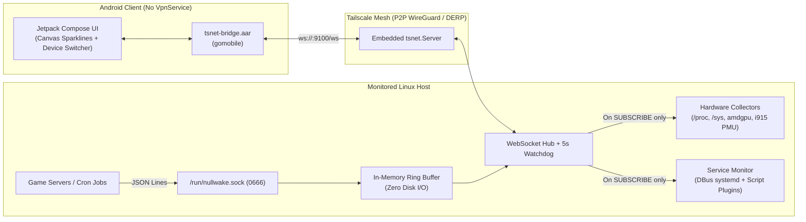
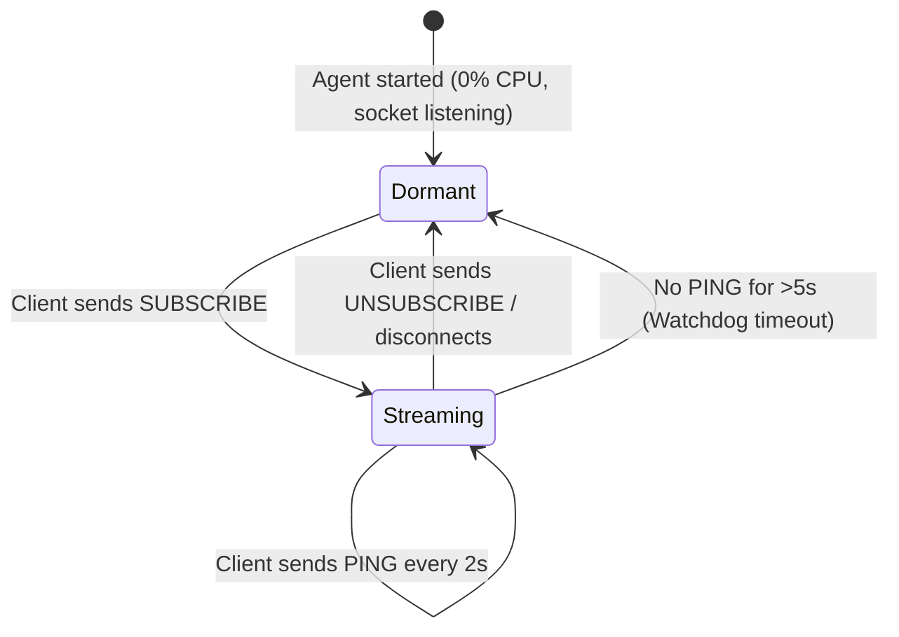

# NullWake

[](https://github.com/HaixueNiyi/NullWake/actions/workflows/build.yml)

**NullWake** is an ultra-lightweight, open-source, **strictly on-demand** system and service monitoring suite for Linux hosts and Android devices.

- **Zero Public Exposure & Zero SSH:** No public TCP/UDP ports, no reverse proxies, no SSH keys, and no web dashboard exposed on the monitored host.
- **Dual-End Embedded Tailscale (`tsnet`):** Both the Linux agent and Android viewer embed Tailscale's userspace networking stack (`tailscale.com/tsnet`). On Android, it never invokes `VpnService`, keeping 100% compatibility with your existing VPN or proxy apps.
- **Strict Zero-Idle Polling:** When no Android viewer is actively viewing a host, the Linux agent performs **0% CPU telemetry polling** and **zero disk writes**. Hardware collectors spin up only on `SUBSCRIBE` and halt immediately upon `UNSUBSCRIBE`, backgrounding, or a 5-second `PING` watchdog timeout.
- **Extensible Service Plugins & In-Memory Ring Buffer:** Monitor `systemd` units via DBus, execute custom JSON scripts on demand, or push discrete events to `/run/nullwake.sock` backed by a bounded in-memory ring buffer (`N = 200` events/service).

---

## Architecture



### On-Demand State Machine



---

## Repository Layout

```text
nullwake/
├── .gitignore
├── agent/                  # Static Linux Go daemon (CGO_ENABLED=0)
│   ├── cmd/agent/          # CLI entrypoint (nullwake-agent)
│   ├── internal/
│   │   ├── collector/      # CPU, RAM, Net, AMD/Intel/Headless GPU collectors
│   │   ├── config/         # TOML configuration loader
│   │   ├── netstack/       # Embedded tsnet server, WebSocket hub, 5s watchdog
│   │   ├── protocol/       # Shared JSON message definitions
│   │   └── service/        # DBus systemd checker, script runner, Unix socket ring buffer
│   └── config.example.toml
├── tsnet-bridge/           # Minimal Go wrapper compiled via gomobile to .aar
│   ├── bridge.go           # Start, GetOnlineNodes, SubscribeNode, Unsubscribe, Stop
│   └── build_aar.sh        # gomobile bind with -ldflags="-s -w"
├── android/                # Native Kotlin + Jetpack Compose + Material 3 app (R8 enabled)
├── deploy/                 # systemd unit (CAP_PERFMON) & Ubuntu/Debian/Arch installer
└── README.md
```

---

## WebSocket Protocol (`ws://<tailscale-ip>:9100/ws`)

### Client -> Agent
- `{"type": "SUBSCRIBE", "interval_ms": 1000}` — Wakes hardware collectors, streams an immediate initial telemetry snapshot (including service statuses and ring-buffer history), and ticks at `interval_ms`.
- `{"type": "PING"}` — Sent every 2 seconds while the Android UI is in the foreground. If >5 seconds elapse without `PING`, the agent terminates the session and resets all collectors.
- `{"type": "UNSUBSCRIBE"}` — Immediately stops hardware telemetry collection and returns the agent to sleep.

### Agent -> Client
```json
{
  "type": "TELEMETRY",
  "timestamp": 1730000000,
  "data": {
    "cpu": { "usage_percent": 24.5, "freq_mhz": 3600, "temp_c": 49.2 },
    "ram": { "used_mb": 4096, "total_mb": 16384, "swap_used_mb": 0 },
    "net": { "rx_bytes_sec": 124800, "tx_bytes_sec": 34200 },
    "gpu": {
      "vendor": "amd",
      "name": "AMD Radeon RX 6700 XT",
      "usage_percent": 42.0,
      "vram_used_mb": 2048,
      "vram_total_mb": 12288,
      "temp_c": 58.0
    },
    "services": [
      {
        "id": "mc",
        "name": "Minecraft Server",
        "status": "running",
        "summary": "3/20 players online",
        "metrics": { "players": 3, "tps": 20.0 },
        "history": [
          { "ts": 1730000000, "event": "PlayerAlice joined" }
        ]
      }
    ]
  }
}
```
> **Note:** On headless servers/VPS hosts without a supported DRM GPU, `gpu` is serialized as `null`, and the Android UI hides the GPU card automatically.

---

## Quickstart: Linux Agent (Ubuntu / Debian / Arch)

### 1. Clone, Build & Install via Script
```bash
git clone https://github.com/HaixueNiyi/NullWake.git
cd NullWake
sudo ./deploy/install.sh
```
This builds a static single binary (`CGO_ENABLED=0`), creates the `nullwake` system user, installs `/etc/nullwake/config.toml` from `agent/config.example.toml`, and installs `deploy/nullwake-agent.service` with `AmbientCapabilities=CAP_PERFMON` for unprivileged Intel iGPU PMU telemetry (`i915/rcs0-busy`).

> Prebuilt static Linux binaries (`nullwake-agent-linux-amd64`) and Android APKs (`nullwake-android-arm64-v8a-release.apk`, `nullwake-android-arm64-v8a-debug.apk`) are published on [GitHub Releases](https://github.com/HaixueNiyi/NullWake/releases) and built automatically via [GitHub Actions](https://github.com/HaixueNiyi/NullWake/actions).

### 2. First-Run Tailscale Login
Either set `auth_key` in `/etc/nullwake/config.toml` (or `TS_AUTHKEY`) before starting, or start the service and follow logs for the interactive login URL:
```bash
sudo systemctl start nullwake-agent
journalctl -u nullwake-agent -f
```

### 3. Pushing Events to the In-Memory Ring Buffer
The agent listens on `/run/nullwake.sock` (default mode `0666`) without waking hardware collectors or writing to disk:
```bash
echo '{"service_id":"mc","event":"PlayerAlice joined"}' | nc -U -N /run/nullwake.sock
```
Even if a `service_id` is not declared in `config.toml`, it automatically appears in the Android dashboard once an event is pushed.

### 4. GPU Telemetry Notes
- **AMD (`amdgpu`):** Reads `gpu_busy_percent`, `mem_info_vram_used`, `mem_info_vram_total`, and `hwmon/temp1_input` from `/sys/class/drm/card*/device/`.
- **Intel (`i915`):** Opens the `i915/rcs0-busy` perf PMU descriptor strictly while subscribed (`CAP_PERFMON` provided by systemd), falls back to kernel sysfs `rc6_residency_ms` idle delta (accurate without root), then `intel_gpu_top -J` or `rps_act_freq_mhz / gt_max_freq_mhz`. PMU file descriptors are closed immediately on `UNSUBSCRIBE`.
- **Headless / VPS:** Cleanly disabled (`"gpu": null`).

---

## Building the Android Client

### 1. Compile the `tsnet-bridge.aar` via `gomobile`
Ensure `gomobile` and Android NDK are installed:
```bash
go install golang.org/x/mobile/cmd/gomobile@latest
gomobile init
./tsnet-bridge/build_aar.sh
```
This generates `android/app/libs/tsnet-bridge.aar` (gitignored).

### 2. Build the Release APK (with R8 Minification)
```bash
cd android
gradle assembleRelease
```
Or open the `android/` directory in Android Studio and run/build `:app`.

### 3. Android Proxy Support
In the Android **Settings** screen, you can optionally configure a local control-plane proxy (e.g. `socks5://127.0.0.1:10808` or `http://127.0.0.1:10809`). This configures `HTTP_PROXY` / `HTTPS_PROXY` inside the Go runtime so Tailscale coordination and DERP TCP handshakes traverse your local proxy while WireGuard UDP peer-to-peer traffic remains direct—without creating an Android `VpnService`.

---

## Development & Testing

Run unit tests for both Go modules with CGO disabled:
```bash
cd agent && CGO_ENABLED=0 go test -v ./...
cd ../tsnet-bridge && CGO_ENABLED=0 go test -v ./...
```
